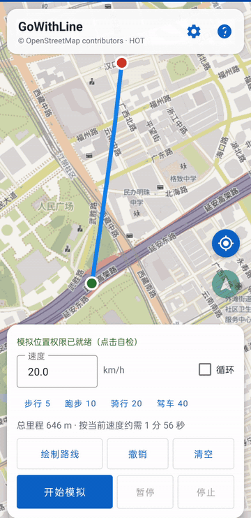
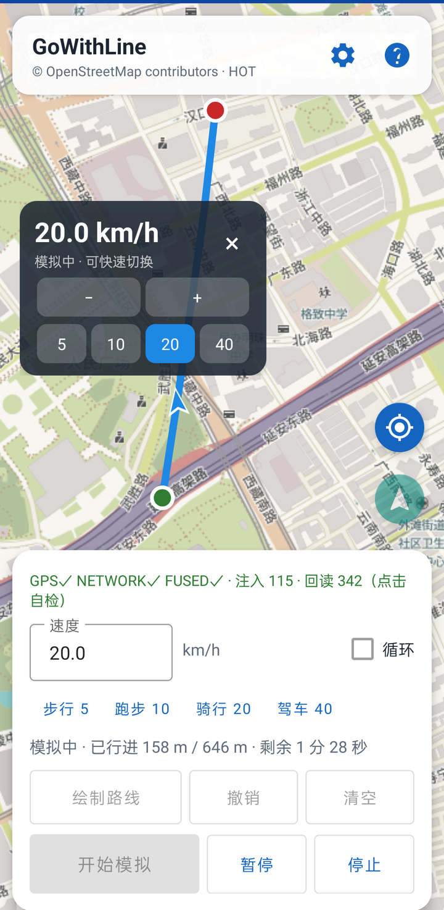
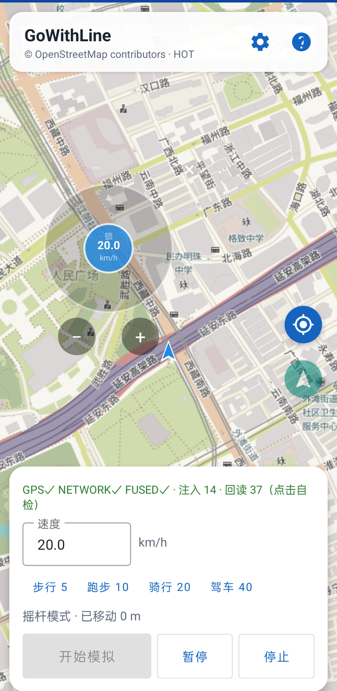
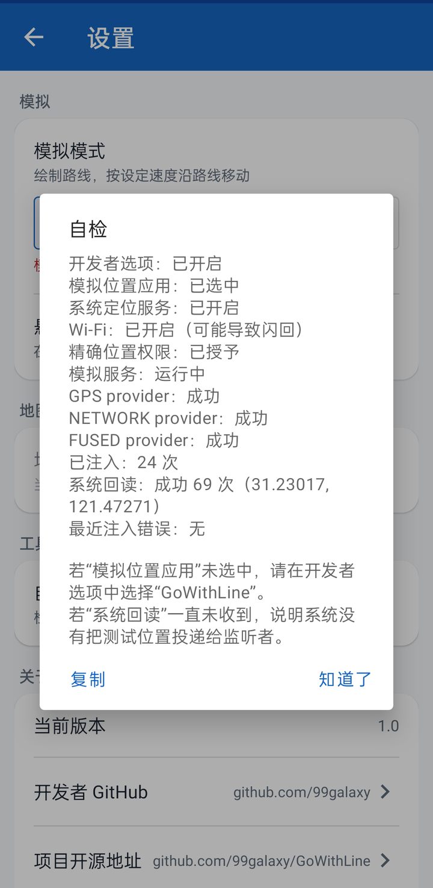

# GoWithLine 路线模拟

在地图上绘制路线，让手机定位按设定速度平滑移动。免 Root、无账号、无广告的开源 Android 定位测试工具。[English](README.en.md)

[](https://github.com/99galaxy/GoWithLine/releases/latest)
[](LICENSE)




**[下载最新 APK](https://github.com/99galaxy/GoWithLine/releases/latest)** · 约 5 MB · Android 8.0+ · SHA-256 见 Release 页

| 适用场景 | 不适用场景 |
|---|---|
| 开发调试、教学演示、地图与轨迹类 App 的定位功能测试 | 考勤打卡、校园跑/体测、游戏虚拟定位，或任何旨在绕过安全检测的用途 |

本应用通过 Android 开发者调试 API 注入模拟位置。部分应用具备识别模拟定位的能力（如通过 `isFromMockProvider`、FusedLocation 或厂商专有 SDK）；在非 Root 环境下无法绕过此类检测，这也并非本项目的开发目标。

  

## 功能特性

- **手绘路线**：单指滑动即可绘制多段路线，系统自动闭合连结；支持单步撤销与一键清空。**绘制过程中支持双指缩放或平移地图**，抬手后即可无缝继续单指画线。
- **恒定速度**：支持以 km/h 精确输入，内置步行、跑步、骑行、驾车等常用快捷预设档位，模拟过程中支持实时动态调速。
- **平滑移动**：依据物理真实时间推进里程，沿折线平滑插值经纬度与航向方位角（Bearing）；同时向 GPS、NETWORK 与 FUSED 三个测试 Provider 注入（不同机型生效组合因系统实现而异）。
- **完整状态控制**：支持随时暂停、继续与停止。暂停期间与到达终点后仍持续广播最后位置，避免系统定位意外闪回；停止模拟后自动注销测试 Provider，无缝恢复真实定位。
- **实用配套**：支持路线循环巡航、地图视角跟随、前台通知栏快捷控制（暂停/继续/停止）以及 WakeLock 屏幕常亮防休眠。
- **悬浮速度窗**：覆盖在其他应用上层显示当前模拟速度，支持自由拖动、`−/+` 步进微调与 5/10/20/40 km/h 快捷切换，可一键收起隐藏。
- **虚拟摇杆模式**：无需预先绘制路线。开启后悬浮窗呈现精简虚拟摇杆，仅控制行进方向，按预设速度移动，推杆即走、松手即停，适合即兴探索或不便提前规划路线的场景。
- **方向锁定巡航**：轻触摇杆中心球（摇杆头）即可在锁定/解锁状态间切换；锁定后松手仍将沿当前方向持续行进，再次点击即可停止。
- **极简摇杆悬浮窗**：摇杆模式下精简悬浮窗面板，仅保留半透明摇杆与 `−/+` 调速按钮；当前速度、单位及锁定状态直观集成在摇杆头上。
- **集中设置页**：模拟模式、悬浮窗开关、地图图层、环境自检与关于信息统一归集管理。
- **关于与更新**：内置版本查看、开发者 GitHub 主页导航、开源仓库地址及基于 GitHub Releases 的更新检查。
- **状态持久化**：自动保存手绘路线、设定速度、循环开关、图层配置、模拟模式与地图中心点，重启应用自动恢复。
- **多源地图图层**：
  - **OpenStreetMap**（WGS-84，内置）：采用 OpenStreetMap France 提供的 HOT 风格瓦片镜像。
  - **自定义 XYZ 瓦片**（支持 WGS-84 / GCJ-02）：支持接入用户拥有合法使用权限的第三方瓦片服务。
  - 在「设置 → 地图图层」中选择「自定义 XYZ…」，确认后填写包含 `{z}`、`{x}`、`{y}` 的 URL 模板（例如 `https://tiles.example.com/{z}/{x}/{y}.png`）并选择对应坐标系即可。

> 本项目仅内置 OpenStreetMap（HOT 瓦片样式，地图数据 © OpenStreetMap contributors，遵循 ODbL 协议）。如需其他底图，请通过自定义 XYZ 接入您拥有使用权限的瓦片源。内置瓦片可能因网络环境或服务策略出现加载延迟；自定义模板服务亦须确保能从当前设备网络正常访问。

## 使用指南

1. **安装与授权**：安装 APK 并打开应用，阅读并同意使用声明（请勿用于考勤打卡、校园跑/体测或游戏定位等违规场景），按提示授予定位与通知权限。
2. **启用开发者选项与模拟位置**：
   - 前往系统「设置 → 关于手机」，连续点击“版本号” 7 次以启用开发者模式；
   - 前往系统「设置 → 开发者选项 → **选择模拟位置信息应用**」，选中“GoWithLine”。
3. **路线模式**：点击主界面“绘制路线”，单指在地图上滑动即可画线；绘制过程中可随时通过双指缩放或拖动地图，松开双指后继续单指画线。支持分多段绘制，绘制完成后点击“结束绘制”退出绘制模式。
4. **启动模拟**：输入行进速度（km/h），按需开启“循环”选项，点击“开始模拟”。
5. **模拟控制**：模拟运行中可随时暂停、继续或停止；下拉通知栏亦提供快捷控制。停止模拟后将自动恢复系统真实定位。
6. **摇杆模式**：
   - 点击标题栏齿轮进入「设置 → 模拟模式」，选择 **摇杆模式**（首次启用需授予“显示在其他应用上层”悬浮窗权限）；
   - 返回主界面点击“开始模拟”，屏幕上将呈现极简半透明摇杆与 `−/+` 调速按钮；
   - 拖动摇杆即可按设定速度控制移动方向，松手即停，无需预先绘制路线；
   - 摇杆头实时显示当前速度（km/h）及微弱的锁定图标，轻触摇杆头可切换锁定/解锁；
   - 锁定后松手仍将保持当前偏转方向继续移动；再次轻触摇杆头即可停止；
   - 锁定状态下再次拖动摇杆可平滑调整航向：摇杆从当前位置平滑跟随手指转动，不会跳跃至手指落点；松手后平滑锁定新方向继续巡航；
   - 悬浮窗顶部的拖动手柄可用于调整整个控件位置，`−/+` 按钮支持每次微调 1 km/h。
7. **悬浮速度窗**：前往「设置 → 悬浮速度窗」（首次使用将跳转至系统授权页）。在路线模式下运行模拟时显示实时速度与快捷档位；在摇杆模式下将强制启用并直接呈现虚拟摇杆。
   - 若重新安装应用，系统可能重置悬浮窗权限，此时开关会提示授权，按指引重新开启即可。
8. **自定义地图图层**：前往「设置 → 地图图层」，选择「自定义 XYZ…」并确认，输入瓦片 URL 模板并选择对应坐标系（WGS-84 或 GCJ-02），确认后返回地图即可自动应用并换算已有路线。模板必须包含 `{z}`、`{x}`、`{y}` 占位符，例如 `https://tiles.example.com/{z}/{x}/{y}.png`。
9. **环境自检**：前往「设置 → 自检」，可一键检测开发者选项开启状态、模拟位置应用选择、系统定位服务、Provider 注入状态以及系统回读结果。
10. **关于与检查更新**：前往「设置 → 关于」，可查看当前版本（1.1）、开发者 GitHub 主页、开源仓库地址并检查新版本。
    - 检查更新基于 GitHub Releases API；受网络环境影响若检查失败，弹窗将提供 Releases 页面快捷入口。

> 首次启动若提示权限不足，按照应用内对话框指引跳转至系统设置开启对应权限即可。

## 实现原理

### 1. 免 Root 模拟定位机制

`MockLocationService` 作为前台服务（声明 `foregroundServiceType="location"`）运行，启动后执行以下逻辑：

1. 通过 `LocationManager.addTestProvider(...)` 注册 GPS、NETWORK 与 FUSED 三个测试 Provider；
2. 内部定时器每 200 ms 调用一次 `setTestProviderLocation()` 注入最新的模拟位置；
3. 构造的 `Location` 对象完整填充经纬度、海拔、精度、航向角（Bearing）、速度、时间戳与 `elapsedRealtimeNanos`；针对 GPS Provider 还会注入卫星颗数等额外 Extras 信息；
4. 停止模拟时，规范调用 `setTestProviderEnabled(false)` 并执行 `removeTestProvider()` 彻底注销。

该设计借鉴了 GoGoGo 项目中 `ServiceGo` 的实现经验；在 Android 12+（API 31+）上使用 `ProviderProperties` 定义功率与精度常量，旧版本则兼容回退至 `Criteria` 常量。

### 2. 坐标系转换与对齐

- 地图上的手绘轨迹点、路线、标记与地图中心统一采用当前图层所使用的坐标系。
- 内置 OpenStreetMap 为 WGS-84 坐标系；接入国内常见的 GCJ-02（火星坐标系）自定义图层时需进行纠偏转换。
- 坐标转换遵循“系统边界单向换算”原则：仅在与系统底层交互时换算——启动模拟时将 GCJ-02 路线点统一转换为 WGS-84 注入系统；界面展示当前模拟位置时，再将底层的 WGS-84 实时转回 GCJ-02 渲染至地图。
- 切换不同坐标系的地图图层时，应用会自动换算已有路线与地图中心，避免图层切换导致视觉偏移。
- 这一思路与 GoGoGo 中将百度 BD-09 坐标转为 WGS-84 再传给系统定位 API 的设计一致。

### 3. 路线推进算法

几何运算层采用纯 Java 实现，脱离 Android SDK 依赖，确保计算纯粹与单元测试完备：

- `GeoMath`：提供 Haversine 大圆距离测算与初始方位角（Bearing）计算；
- `RoutePath`：维护路线累计距离序列，根据当前累计行程线性插值经纬度，并通过前后邻近点差分计算当前朝向角；
- `RouteSimulator`：核心步进状态机，按 `traveled += speed × Δt` 推进里程，完整支持暂停、完成判定及循环路程取模；
- `RouteSimplifier`：采用 Douglas-Peucker 算法抽稀并平滑手绘原始轨迹点。

后台服务通过 `SystemClock.elapsedRealtime()` 获取高精度真实时间差计算 Δt，避免由于 Handler 调度延迟累积造成速度偏差。

### 4. 摇杆模式设计

- 用户偏好中持久化保存 `simulation_mode`，启动时经由主界面组装 Intent 传递至后台服务。
- 摇杆模式下不构建预设路线：服务以当前地图中心（WGS-84）为起点，每帧按 `speed × Δt` 沿摇杆所指方位角调用 `GeoMath.destinationPoint()` 计算下一个航路点。
- 虚拟摇杆仅负责输出方向角与激活状态（active），行进速度严格遵循界面/悬浮窗所设定的 km/h 恒定值；松手或暂停即刻停止移动。
- 摇杆组件直接绘制在系统顶级悬浮窗（`TYPE_APPLICATION_OVERLAY`）内，切换至后台或其他应用仍可自由操控。
- 摇杆锁定状态由视图内部维护：轻触摇杆头切换锁定；未锁定状态下松手自动回弹归零并停止上报；锁定状态下松手保留摇杆偏转角并持续上报激活状态，服务继续按设定速度巡航。

## 常见问题

### 开发者选项列表中找不到“GoWithLine”

Android 系统的“选择模拟位置信息应用”列表仅会展示在 `AndroidManifest.xml` 中声明了 `android.permission.ACCESS_MOCK_LOCATION` 权限的应用。本项目已在清单中配置该声明（此权限无需运行时授予，仅用作进入系统开发者候选列表的凭证）。若列表中未显示，请按以下步骤排查：

- 确认安装的是官方最新构建的 APK（可从 [Releases](https://github.com/99galaxy/GoWithLine/releases/latest) 获取）；
- 部分厂商定制 ROM 存在列表缓存延迟，建议退出设置重新打开，或重启手机后再尝试查看；
- 若依然未出现，可通过 ADB 命令行直接授权：
  ```bash
  adb shell appops set com.gowithline.mock android:mock_location allow
  ```
  *（需先安装应用并授予定位权限）。*

### 模拟已启动，但地图或其他应用中的位置未发生改变

请先打开应用右上角「设置 → 自检」，点击“复制”导出诊断信息。自检面板将呈现以下关键排查项：

- **开发者环境**：开发者选项是否开启、模拟位置应用是否准确选中 GoWithLine；
- **系统服务状态**：系统定位总开关、Wi-Fi 状态、精确位置（Precise Location）权限授予情况；
- **Provider 注入**：GPS / NETWORK / FUSED 三个测试 Provider 是否全部注册成功；
- **数据注入统计**：后台已执行的位置注入累计次数；
- **系统回读（关键指标）**：后台服务注册了系统位置监听器以校验注入有效性。若系统内核已采纳模拟位置，此处将显示“成功 N 次”；若该数值始终为 0，说明注入在系统底层被拦截或未生效，问题通常源于权限或 ROM 机制，而非 UI 渲染层。

**常见诱因及对策**：

1. **未在开发者选项中选中 GoWithLine**：自检显示“未选中”。请前往开发者选项重新选择。
2. **系统定位总开关未开启**：自检显示“已关闭”。请开启系统定位服务后重试。
3. **仅授予了“粗略位置”权限**：自检显示“未授予精确位置”。请前往系统应用权限设置，将定位权限调整为“精确位置”。
4. **系统 Wi-Fi 辅助定位干扰**：部分机型开启 Wi-Fi 或融合定位时会强制覆盖模拟坐标，导致定位反复闪回。请尝试暂时关闭 Wi-Fi 或在系统设置中关闭“Wi-Fi 扫描”。
5. **Provider 注册失败**：自检会附带抛出的具体异常信息，常见于部分定制 ROM 对系统级 `addTestProvider` 接口的深度权限限制。
6. **系统回读计数正常，但特定应用内的位置依然不动**：该应用可能采用了 Google Play Services 的 FusedLocationProvider、内置专有定位 SDK，或在代码层面主动检测了 `location.isFromMockProvider()` 标志位。此类应用在非 Root 环境下通常无法被常规模拟。

**进一步的 ADB 诊断命令**：

```bash
adb shell appops get com.gowithline.mock android:mock_location
adb logcat -d -s GoWithLineService | tail -100
adb shell dumpsys location | grep -A4 -i "last location"
```

> 若自检显示 GPS/NETWORK 注入正常且注入次数持续递增，但“系统回读”始终为 0，欢迎提交 Issue 并附上自检导出文本以及 `adb logcat -s GoWithLineService` 的日志输出，以便协助排查是系统权限拦截还是 Provider 参数兼容性问题。

### 绘制路线时如何缩放或平移地图？

在路线绘制模式下：

- **单指操作**：按住并在地图上滑动即可绘制路线轨迹；
- **双指操作**：支持双指捏合缩放或双指拖动平移地图。在检测到双指落地的瞬间，当前未抬手的那一段临时划痕会被自动丢弃，避免误绘杂线；松开双指后直接换回单指即可无缝继续画线。

### 地图显示空白或瓦片无法加载

本项目默认仅内置 OpenStreetMap（由 OpenStreetMap France 托管的 HOT 样式服务），其瓦片加载可能受国际网络波动、地域访问限制或服务节点策略影响。若瓦片加载失败，建议前往「设置 → 地图图层」，选择「自定义 XYZ…」并确认，填入您拥有合法访问权限的第三方瓦片 URL 模板和对应坐标系。模板中必须包含 `{z}`、`{x}`、`{y}` 占位符（例如 `https://tiles.example.com/{z}/{x}/{y}.png`），确认返回即可即时生效。本项目不内置离线地图包，亦不分发任何第三方商业地图瓦片。

## 更新日志

### 1.1

- 界面优化：主界面与设置页重排视觉层级，新增模拟模式徽标，触控目标不小于 48dp。
- 修复「设置 → 地图图层」选择器不显示选项的问题，自定义 XYZ 图层恢复配置入口。
- 自检的“系统回读”不再把附近的真实定位误计为模拟回读。
- 补充自定义 XYZ 瓦片的配置步骤说明。

### 1.0

首个正式版本。

- 支持手绘多段路线，绘制中支持双指手势缩放/平移；按设定 km/h 恒定速度沿折线平滑移动。
- 同时向 GPS / NETWORK / FUSED 三个测试 Provider 注入；支持暂停/继续/停止及路线循环。
- 支持虚拟摇杆模式与航向锁定巡航；配备悬浮速度窗；支持 OpenStreetMap 及自定义 XYZ 瓦片图层。
- 内置环境自检工具；停止模拟后自动移除测试 Provider 并恢复系统真实定位。
- 遵循 GPL-3.0 开源协议，无账号、无广告、无自建后端，兼容 Android 8.0+。

## 一点个人的碎碎念

老实摇杆，很枯燥吧？.jpg

之前一直习惯用影梭模拟位移，但很多时候自己手动推着摇杆实在不太方便，想要稳定复现一条固定路线和设定速度就更费劲了。于是让大肥鱼折腾了这个支持自定义画路线的小工具。

况且影梭也已经转为闭源了~

测试 Provider 的底层注入思路借鉴了影梭，地图与路线推进算法则是完全独立实现的。

欢迎Issue和PR~

## 编译构建

**环境要求**：JDK 17+、Android SDK Platform 36、Build-Tools 36.0.0。

```bash
cd GoWithLine
./gradlew assembleDebug
```

构建产物路径：`app/build/outputs/apk/debug/app-debug.apk`（Debug 签名，仅供本地开发调试）。

### 发布签名配置

1. 在项目仓库之外生成并妥善保管 Release 签名密钥库文件（keystore，一旦遗失将无法发布覆盖升级版本）；
2. 在本地 Gradle 用户根目录下的 `gradle.properties` 文件中补充签名配置（默认路径为 `~/.gradle/gradle.properties`；若配置了环境变量 `GRADLE_USER_HOME`，请前往对应目录配置；**切勿将密钥提交至 Git 仓库**）：

```properties
GOWITHLINE_STORE_FILE=<path>/gowithline-release.jks
GOWITHLINE_STORE_PASSWORD=...
GOWITHLINE_KEY_ALIAS=gowithline
GOWITHLINE_KEY_PASSWORD=...
```

3. 执行 Release 构建：

```bash
./gradlew assembleRelease
```

构建产物路径：`app/build/outputs/apk/release/app-release.apk`。

### 运行单元测试

```bash
./gradlew :app:testDebugUnitTest
```

## 目录结构

```
app/src/main/java/com/gowithline/mock/
├─ MainActivity.java                主界面控制：地图交互、手绘轨迹、调速与权限流转
├─ geo/                             纯 Java 几何计算：坐标转换、路径管理、步进模拟器与曲线抽稀
├─ map/                             地图集成：osmdroid 图层配置与自定义 XYZ 瓦片源
├─ service/MockLocationService.java 核心前台服务：测试 Provider 注入、状态广播与常驻通知
├─ ui/DrawOverlayView.java          顶层手绘交互覆盖层视图
└─ util/                            通用工具：模拟位置环境自检、格式化与辅助方法
```

## 隐私说明

- **零数据收集**：本应用无账号系统、无自建后端、不集成任何第三方广告或统计分析 SDK；手绘路线、设定速度、图层偏好及地图中心坐标仅保存在本地设备存储（SharedPreferences）中。
- **瓦片网络请求**：内置 OpenStreetMap 瓦片服务由 OpenStreetMap France 提供的 HOT 节点承载；若配置了自定义 XYZ 瓦片，请求将直连您指定的服务器。瓦片请求过程中，对应地图服务节点会依据网络协议获取您的请求 IP 地址及所请求的图块坐标。

详情请参阅 [PRIVACY.md](PRIVACY.md)。

## 免责声明

本应用通过 Android 官方开发者调试 API 实现模拟位置注入，设计初衷仅用于软件开发测试、教学演示以及定位功能的技术调试。请勿将本应用用于考勤打卡、校园跑/体测成绩作弊、游戏虚拟定位或任何违反法律法规及第三方平台服务协议的用途。部分应用具备识别模拟定位的能力，各品牌手机系统的限制机制亦有所差异；使用本应用即代表您已知晓上述特性并自愿承担因使用不当产生的所有后果与责任。

## 开源许可

Copyright (C) 2026 99galaxy

本项目基于 [GNU General Public License v3.0](LICENSE)（GPL-3.0）协议开源。SPDX 标识符：`GPL-3.0-only`。

```
This program is free software: you can redistribute it and/or modify
it under the terms of the GNU General Public License as published by
the Free Software Foundation, version 3 of the License.

This program is distributed in the hope that it will be useful,
but WITHOUT ANY WARRANTY; without even the implied warranty of
MERCHANTABILITY or FITNESS FOR A PARTICULAR PURPOSE.  See the
GNU General Public License for more details.

You should have received a copy of the GNU General Public License
along with this program.  If not, see <https://www.gnu.org/licenses/>.
```

“GoWithLine”与“路线模拟”之项目名称与应用图标保留所有权利，不随源码一同授予商标许可；此项属于 GPLv3 协议第 7 条 (e) 款所允许的商标及标识权利保留条款，不构成对 GPL 许可条款的额外限制。所依赖的第三方开源库、地图数据及瓦片服务的版权与授权条款详见 [THIRD_PARTY_NOTICES.md](THIRD_PARTY_NOTICES.md) 与 [NOTICE](NOTICE)。

## 致谢

- [ZCShou/GoGoGo](https://github.com/ZCShou/GoGoGo)：参考了其免 Root 模拟定位实现思路与跨坐标系纠偏处理逻辑。
- [osmdroid](https://github.com/osmdroid/osmdroid)：优秀的 Android 开源地图渲染库（遵循 Apache-2.0 协议）。
- 地图数据版权：© OpenStreetMap contributors（遵循 ODbL 协议）。内置底图瓦片采用 HOT 样式，由 OpenStreetMap France 提供。
